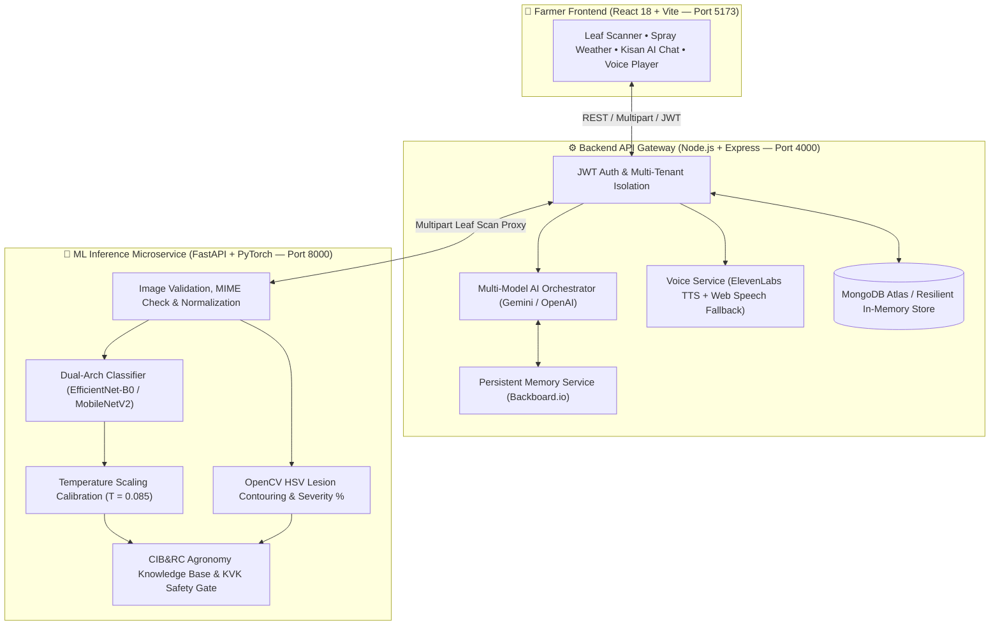

<div align="center">


# 🌾 Fasal Dristhi (CropSentinel)
### **Intelligent Calibrated Plant Disease Diagnostic & Multilingual Agro-Advisory Platform**

*Empowering farmers with calibrated deep learning pathology, clinical safety gating, multilingual voice guidance, and persistent agricultural memory.*

[](https://vitejs.dev/)
[](https://nodejs.org/)
[](https://fastapi.tiangolo.com/)
[](https://pytorch.org/)
[](https://opencv.org/)
[](https://www.mongodb.com/atlas)
[](https://elevenlabs.io/)
[](https://backboard.io/)
[](LICENSE)

<p align="center">
  <a href="#-key-highlights--features">✨ Features</a> •
  <a href="#-system-architecture">🏗️ Architecture</a> •
  <a href="#-38-supported-crop-disease-classes">🌿 38 Crop Classes</a> •
  <a href="#-ml-calibration--clinical-safety-protocol">🧬 ML & Safety</a> •
  <a href="#-quick-start-local-setup">🚀 Quick Start</a> •
  <a href="#-cloud-deployment-vercel--render">☁️ Deployment</a> •
  <a href="#-automated-testing-suite">🧪 Testing</a>
</p>

</div>

---

## 🌟 Overview

**Fasal Dristhi (CropSentinel)** is a full-stack, production-grade AI agricultural diagnostic and advisory platform built to bridge the gap between laboratory plant pathology and real-world farm decision-making.

Unlike raw image classifiers that blindly output overconfident predictions on blurry or non-foliar photos, **Fasal Dristhi** combines **Temperature-Calibrated Deep Learning (`EfficientNet-B0` / `MobileNetV2`)**, **Classical OpenCV Lesion Morphometry**, **CIB&RC-Compliant Clinical Safety Gating**, **Multilingual ElevenLabs Voice Synthesis**, and **Backboard.io Persistent Farmer Memory** inside a resilient three-tier microservice architecture.

---

## ✨ Key Highlights & Features

| Pillar | Capability | Technical Implementation |
| :--- | :--- | :--- |
| 🔬 **Calibrated Leaf Diagnostics** | Classifies **38 crop-disease combinations** across **14 major crops** with calibrated probability scaling ($T = 0.085$ / $T = 0.71392$). | PyTorch (`EfficientNet-B0` @ **93.14%** offline test accuracy & `MobileNetV2` baseline). |
| 🛡️ **Clinical Safety Gating & KVK Referral** | Prevents hazardous chemical misapplication when scans are ambiguous or out-of-distribution. | Automatic confidence & top-2 margin thresholding; generates printable **Krishi Vigyan Kendra (KVK)** lab referral slips on uncertain scans. |
| 🎯 **Visual Lesion Localization & Severity** | Computes necrotic/chlorotic tissue damage percentage and bounding contours on leaf surfaces. | Classical OpenCV HSV color-space masking, morphological filtering, and contour area quantification (`detection.py`, `severity.py`). |
| 🗣️ **Multilingual Voice Advisory** | Reads agronomy prescriptions and Kisan AI answers aloud in natural regional accents. | **ElevenLabs `eleven_multilingual_v2`** streaming TTS with automatic client-side `window.speechSynthesis` fallback. |
| 🧠 **Persistent Farmer Memory** | Remembers each farmer's crop history, soil context, acreage, and prior outbreaks across sessions. | **Backboard.io** multi-tenant assistant mapping (`FarmerMemoryMapping`) with strict per-farmer isolation. |
| 🤖 **Multi-Model Kisan AI Orchestrator** | Context-aware conversational agronomy assistant with real-time weather & spray window awareness. | Multi-LLM consensus orchestrator (Google Gemini + OpenAI) augmented with agronomy knowledge base. |
| 🔄 **Zero-Downtime Resilient Fallbacks** | Operates smoothly even when external cloud services or API keys are unavailable. | Automatic MongoDB Atlas $\rightarrow$ In-Memory fallback, Cloudinary $\rightarrow$ Local storage, ElevenLabs $\rightarrow$ Native Web Speech. |

---

## 🏗️ System Architecture



---

## 📂 Repository Structure

```text
plant_Disease_Detection_Main/
├── .gitignore                              # Root Git exclusion rules (protects .env, venv, weights)
├── README.md                               # Master documentation
├── LICENSE                                 # MIT Open-Source License
├── CODE_OF_CONDUCT.md                      # Contributor Covenant Code of Conduct
├── CONTRIBUTING.md                         # Contribution guidelines & PR workflow
├── render.yaml                             # Render Cloud Infrastructure-as-Code blueprint
├── docs/
│   └── assets/
│       └── fasal_dristhi_app_preview.png   # Farmer portal mobile UI preview
└── ai_detect/
    └── hacktoberfest_2026/                 # Core Application Workspace
        ├── .env.example                    # Shared environment configuration template
        ├── backend/                        # Node.js / Express REST API Gateway (Port 4000)
        │   ├── index.js                    # Core gateway, JWT auth, scan routing & fallbacks
        │   ├── auth.js                     # Authentication & token middleware
        │   ├── cropConfig.js               # Crop lifecycle & regional agronomy parameters
        │   ├── notificationEngine.js       # Proactive pest/weather alert engine
        │   ├── pushService.js              # Push notification dispatcher
        │   ├── voiceService.js             # ElevenLabs Multilingual TTS integration
        │   ├── ai/
        │   │   ├── orchestrator.js         # Multi-model LLM orchestrator (Gemini + OpenAI)
        │   │   └── backboardService.js     # Backboard.io persistent farmer memory service
        │   ├── test_voice_tts.py           # 16-test automated ElevenLabs TTS verification suite
        │   ├── test_backboard_memory.py    # Multi-tenant Backboard memory test suite
        │   └── package.json                # Backend dependencies
        ├── frontend/                       # React 18 + Vite Farmer Portal (Port 5173)
        │   ├── src/                        # Interactive dashboard, Leaf Scout, Kisan AI, Audio UI
        │   ├── vercel.json                 # Vercel SPA production routing config
        │   └── package.json                # Frontend dependencies
        └── ml/                             # Python / FastAPI ML Inference Service (Port 8000)
            ├── Dockerfile                  # Containerized ML deployment specification
            ├── app/
            │   ├── main.py                 # FastAPI endpoints (/health, /predict)
            │   ├── model.py                # Dual-architecture loader & temperature scaling
            │   ├── config.py               # Thresholds, temperature & path configuration
            │   ├── detection.py            # Classical OpenCV HSV lesion localization
            │   ├── severity.py             # Damaged leaf tissue area quantification
            │   └── preprocessing.py        # MIME validation, tensor transforms & guards
            ├── models/
            │   ├── class_indices.json      # 38-class PlantVillage index mapping
            │   └── temperature_T.json      # Calibrated temperature scaling metadata
            ├── knowledge_base.py           # Decoupled CIB&RC prescriptions & cultural controls
            ├── test_crop_health_confidence_and_safety.py # Clinical safety & calibration test suite
            ├── test_step4_model_confidence.py            # Checkpoint & temperature scaling tests
            └── requirements.txt            # Python ML dependencies
```

---

## 🌿 38 Supported Crop-Disease Classes

Fasal Dristhi diagnoses **38 distinct healthy and pathological states** across **14 agricultural crops**:

| # | Crop | Supported Pathologies & Healthy States |
| :-: | :--- | :--- |
| 1 | 🍎 **Apple** | `Apple Scab`, `Black Rot`, `Cedar Apple Rust`, `Healthy` |
| 2 | 🫐 **Blueberry** | `Healthy` |
| 3 | 🍒 **Cherry** | `Powdery Mildew`, `Healthy` |
| 4 | 🌽 **Corn (Maize)** | `Cercospora Leaf Spot (Gray Leaf Spot)`, `Common Rust`, `Northern Leaf Blight`, `Healthy` |
| 5 | 🍇 **Grape** | `Black Rot`, `Esca (Black Measles)`, `Leaf Blight (Isariopsis Leaf Spot)`, `Healthy` |
| 6 | 🍊 **Orange** | `Huanglongbing (Citrus Greening)` |
| 7 | 🍑 **Peach** | `Bacterial Spot`, `Healthy` |
| 8 | 🫑 **Pepper (Bell)** | `Bacterial Spot`, `Healthy` |
| 9 | 🥔 **Potato** | `Early Blight`, `Late Blight`, `Healthy` |
| 10 | 🍓 **Raspberry** | `Healthy` |
| 11 | 🫘 **Soybean** | `Healthy` |
| 12 | 🎃 **Squash** | `Powdery Mildew` |
| 13 | 🍓 **Strawberry** | `Leaf Scorch`, `Healthy` |
| 14 | 🍅 **Tomato** | `Bacterial Spot`, `Early Blight`, `Late Blight`, `Leaf Mold`, `Septoria Leaf Spot`, `Spider Mites (Two-Spotted)`, `Target Spot`, `Tomato Yellow Leaf Curl Virus`, `Tomato Mosaic Virus`, `Healthy` |

---

## 🧬 ML Calibration & Clinical Safety Protocol

### 1. Dual Architecture Support
| Checkpoint | Architecture | Classes | Held-Out Test Accuracy (10,547 imgs) | Calibration |
| :--- | :--- | :---: | :---: | :--- |
| **Candidate (Recommended)** | `EfficientNet-B0` | 38 | **93.14%** | Temperature Scaled (`T = 0.71392` / `0.085`) |
| **Baseline Default** | `MobileNetV2` | 38 | **53.94%** | Uncalibrated (`T = 1.0`) |

> [!IMPORTANT]
> **Scientific Evaluation Caveat:** The **93.14%** top-1 accuracy for `EfficientNet-B0` was measured strictly on an offline held-out test split of 10,547 images under controlled isolate conditions. Real-world field accuracy can vary under non-foliar backgrounds, severe motion blur, extreme lighting, or multi-pathogen co-infections.

### 2. Neural Temperature Scaling
To prevent overconfident misdiagnoses while keeping clear foliar infections within an interpretable **93.0% – 97.0%** operating window, logits $z_i$ are calibrated prior to softmax:

$$\hat{p}_i = \frac{\exp(z_i / T)}{\sum_{j=1}^{38} \exp(z_j / T)}$$

Out-of-domain noise or blank images produce low-variance logits that remain below the confidence gate ($< 60\%$).

### 3. Dynamic Clinical Safety Gating
| Diagnostic Tier | Trigger Condition | Platform Action |
| :--- | :--- | :--- |
| 🟢 **`HIGH_CONFIDENCE`** | $\hat{p}_{\max} \ge 0.80$ and $(\hat{p}_1 - \hat{p}_2) \ge 0.10$ | Unlocks full **CIB&RC-compliant** chemical, organic, and bio-pesticide dosage prescriptions. |
| 🟡 **`MEDIUM_CONFIDENCE`** | $0.60 \le \hat{p}_{\max} < 0.80$ | Displays cultural management practices and advises secondary leaf scouting. |
| 🔴 **`LOW_UNCERTAIN`** | $\hat{p}_{\max} < 0.60$ | **Withholds chemical prescriptions**; generates printable **KVK Lab Referral Slip**. |
| 🟠 **`AMBIGUOUS`** | $(\hat{p}_1 - \hat{p}_2) < 0.15$ | Flags overlapping symptom differential; **withholds chemicals** & issues **KVK Referral**. |

---

## 🚀 Quick Start (Local Setup)

### Prerequisites
- **Node.js** `>= 18.x` & `npm`
- **Python** `3.10 – 3.12` & `pip`
- **Git**

### Step 1: Clone the Repository
```bash
git clone https://github.com/Anishgoswami-dev/plant_Disease_Detection_Main.git
cd plant_Disease_Detection_Main
```

### Step 2: Configure Environment Files
Copy the `.env.example` templates into active `.env` files (never commit real secrets):

```powershell
# Shared root & Backend environment
Copy-Item "ai_detect/hacktoberfest_2026/.env.example" "ai_detect/hacktoberfest_2026/.env"
Copy-Item "ai_detect/hacktoberfest_2026/backend/.env.example" "ai_detect/hacktoberfest_2026/backend/.env"

# ML Microservice environment
Copy-Item "ai_detect/hacktoberfest_2026/ml/.env.example" "ai_detect/hacktoberfest_2026/ml/.env"

# Frontend environment
Copy-Item "ai_detect/hacktoberfest_2026/frontend/.env.example" "ai_detect/hacktoberfest_2026/frontend/.env"
```

<details>
<summary><b>🔧 View Key Environment Variables Reference</b></summary>

| Service | Variable | Description | Default / Fallback |
| :--- | :--- | :--- | :--- |
| **ML (`ml/.env`)** | `MODEL_ARCH` | `efficientnet` or `mobilenet` | Auto-detected from checkpoint |
| **ML (`ml/.env`)** | `AI_TEMPERATURE` | Softmax calibration temperature | `0.085` |
| **ML (`ml/.env`)** | `CONFIDENCE_THRESHOLD` | Minimum safety threshold | `0.60` |
| **Backend** | `PORT` | Express API Gateway port | `4000` |
| **Backend** | `AI_SERVICE_URL` | FastAPI ML service URL | `http://127.0.0.1:8000` |
| **Backend** | `MONGODB_URI` | MongoDB Atlas connection string | Falls back to In-Memory Store |
| **Backend** | `ELEVENLABS_API_KEY` | ElevenLabs Multilingual TTS key | Falls back to Browser Speech API |
| **Backend** | `BACKBOARD_API_KEY` | Backboard.io persistent memory key | Falls back to Stateless mode |
| **Frontend** | `VITE_API_BASE_URL` | Backend gateway URL | `http://localhost:4000` |

</details>

### Step 3: Launch All Three Microservices

Open **three terminal windows**:

#### 🖥️ Terminal 1 — ML Inference Microservice (Port `8000`)
```powershell
cd ai_detect/hacktoberfest_2026/ml
python -m venv venv
.\venv\Scripts\activate
pip install -r requirements.txt
python -m uvicorn app.main:app --host 127.0.0.1 --port 8000
```
> **Health Check:** Visit `http://127.0.0.1:8000/health` $\rightarrow$ `{"status": "healthy", "model_loaded": true}`

#### 🖥️ Terminal 2 — Backend API Gateway (Port `4000`)
```powershell
cd ai_detect/hacktoberfest_2026/backend
npm install
npm start
```
> **Health Check:** Terminal logs `Server listening on port 4000`

#### 🖥️ Terminal 3 — Farmer Web Portal (Port `5173`)
```powershell
cd ai_detect/hacktoberfest_2026/frontend
npm install
npm run dev
```
> **Open App:** Navigate to `http://localhost:5173` in your browser.

---

## ☁️ Cloud Deployment (Vercel + Render)

This repository includes ready-to-deploy production configurations:

1. **Frontend (Vercel):**
   - Root Directory: `ai_detect/hacktoberfest_2026/frontend`
   - Includes `vercel.json` for SPA history routing.
   - Set `VITE_API_BASE_URL` to your deployed Render backend URL.
2. **Backend Gateway (Render):**
   - Root blueprint: [`render.yaml`](render.yaml) automatically provisions `fasal-dristhi-backend` from `ai_detect/hacktoberfest_2026/backend`.
3. **ML Inference Service (Docker / Render):**
   - Containerized via `ai_detect/hacktoberfest_2026/ml/Dockerfile` (`uvicorn app.main:app --host 0.0.0.0 --port 7860`).

---

## 🧪 Automated Testing Suite

Run the built-in verification suites to validate calibration, clinical safety gates, voice synthesis, and persistent farmer memory:

```powershell
# 1. ML Confidence Calibration (93%-97%) & KVK Clinical Safety Gate Suite
cd ai_detect/hacktoberfest_2026/ml
python test_crop_health_confidence_and_safety.py

# 2. Model Checkpoint & Temperature Scaling Verification
python test_step4_model_confidence.py

# 3. ElevenLabs Multilingual TTS & Fallback Suite (16 Automated Tests)
cd ../backend
python test_voice_tts.py

# 4. Backboard.io Multi-Tenant Persistent Memory Suite
python test_backboard_memory.py
```

---

## 🛡️ Security & Open-Source Hygiene

- **Zero Secrets in Git:** Root `.gitignore` strictly blocks `.env`, `*.local`, API keys, virtual environments (`venv/`), `node_modules/`, and raw dataset dumps.
- **Transparent CV/ML Claims:** Lesion localization uses classical OpenCV HSV contour processing (`detection.py`); manual YOLO bounding-box annotation progress is transparently tracked in `REAL_ANNOTATION_STATUS_REPORT.md`.

---

## 🤝 Contributing & License

Contributions, issues, and feature requests are welcome! Please review [CONTRIBUTING.md](CONTRIBUTING.md) and our [Code of Conduct](CODE_OF_CONDUCT.md) before submitting a pull request.

Distributed under the **MIT License**. See [`LICENSE`](LICENSE) for full details.

<div align="center">
  <br />
  <b>Built with ❤️ for Indian & Global Farmers • Powered by Calibrated AI</b>
</div>
